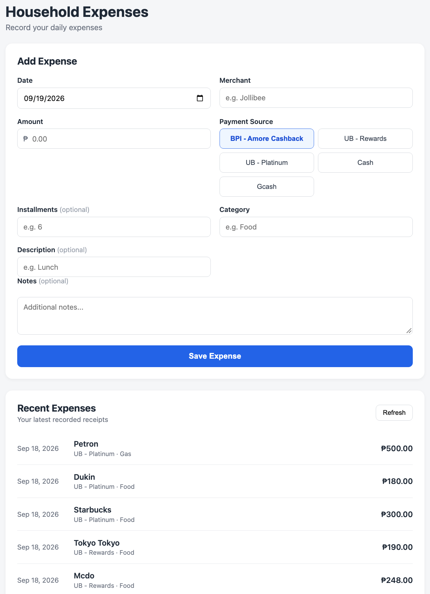
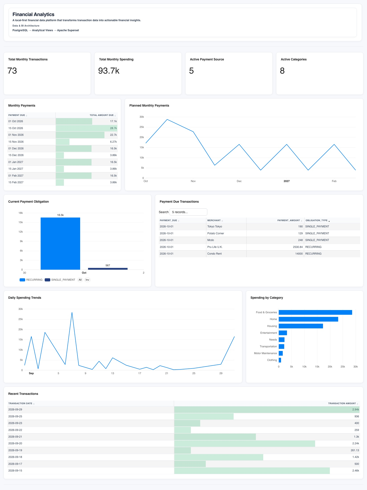
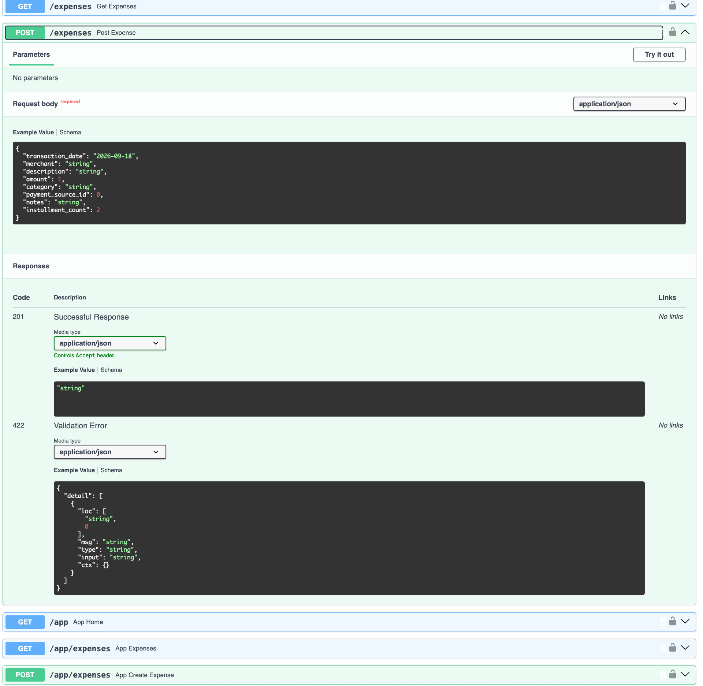

# Finance Data Platform

A self-hosted **household financial data platform** for capturing, storing, modeling, and analyzing financial transactions using PostgreSQL, FastAPI/Python, SQL, and Apache Superset.

## Why I Built This

Household financial activity can be spread across different payment sources and informal reimbursement arrangements. Without a consistent data model, it is difficult to understand original spending, upcoming payment obligations, recurring commitments, and amounts owed between people.

This project brings those concerns into a structured platform by separating **transaction capture, persistent storage, payment modeling, interpersonal settlement, and analytics**.

The goal is to maintain PostgreSQL as the source of truth, use database-controlled logic for financial-domain rules, and expose purpose-specific analytical datasets for reporting.

## Project Snapshot

| Area | Implementation |
|---|---|
| Purpose | Household financial data capture, modeling, payment tracking, and analytics |
| Architecture | Web Application → FastAPI → PostgreSQL → Analytical Views → Apache Superset |
| Primary Database | PostgreSQL |
| Backend | Python / FastAPI |
| Frontend | HTML / CSS / JavaScript |
| Analytics & Visualization | Apache Superset |
| Core Design | Original transactions remain distinct from derived payment and settlement records |
| Current Milestone | Transaction obligation modeling, recurring expenses, and cash payment/interpersonal settlement V1 |

## What the Platform Includes

- A web interface for transaction capture and retrieval
- A FastAPI backend for request validation, authentication, and database operations
- PostgreSQL as the structured data layer and source of truth
- Relational modeling for transactions, payment sources, credit cards, installment plans, and recurring commitments
- Optional 0% credit-card installment scheduling
- Database-controlled installment payment-date calculation, allocation, and reconciliation
- Database-controlled recurring schedule generation and future-dated transaction materialization
- A `payment_obligations` semantic layer for single-payment credit-card, installment, and recurring obligations
- Transaction ownership and participant concepts for interpersonal allocation
- Cash settlement allocations and cash statements for eligible cash and e-wallet transactions
- PostgreSQL analytical views for transaction, payment, and participant-level analysis
- Apache Superset as the reporting and visualization layer
- Application authentication and API authentication
- Documentation for architecture, data modeling, analytics, API behavior, and technical decisions

The project demonstrates implementation across **data modeling, backend/API development, financial-domain business logic, database-controlled processing, data integrity, analytical modeling, and reporting**.

## Architecture

```text
                         Finance Data Platform

User
 |
 v
Web Application
(HTML / CSS / JavaScript)
 |
 v
FastAPI
 |
 v
PostgreSQL
 |
 +-- Operational Data
 |     |
 |     +-- transactions
 |     +-- people / transaction participants
 |     +-- payment_sources
 |     +-- credit_cards
 |     +-- installment_plans
 |     +-- installment_schedule
 |     +-- recurring_expenses
 |     +-- recurring_schedule
 |
 +-- Payment Modeling
 |     |
 |     +-- payment_obligations
 |
 +-- Interpersonal Settlement
 |     |
 |     +-- cash_settlements
 |     +-- cash_statements
 |
 +-- Analytical Views
       |
       +-- vw_transactions
       +-- vw_monthly_payments
       +-- vw_payment_obligation_participants
               |
               v
       Apache Superset
       (Reporting & Visualization)
```

### Architectural Principles

- **PostgreSQL is the source of truth.** The application and analytical tools use the same central data layer.
- **Keep the original spending event intact.** Installment schedule rows, payment obligations, and reimbursement allocations do not represent additional purchases.
- **Keep business rules close to the data.** Installment and recurring-generation workflows use database-controlled logic.
- **Separate operational and analytical responsibilities.** Purpose-specific views provide reporting structures without replacing operational tables.
- **Make grain explicit.** Participant-level views can contain multiple rows per payment obligation and must be aggregated accordingly.

## Core Financial Models

### Transactions and Payment Obligations

The `transactions` table is the canonical record of a spending event. The system-derived `obligation_type` distinguishes transaction payment behavior:

- `NORMAL` — normal non-recurring transaction
- `SINGLE_PAYMENT` — credit-card transaction without an installment plan
- `RECURRING` — transaction materialized from a recurring expense
- `INSTALLMENT` — credit-card transaction associated with an installment plan

The `payment_obligations` layer represents payment obligations for single-payment credit-card transactions, installment transactions, and recurring-generated transactions. It does not turn payment obligations into separate spending transactions.

### Credit-Card Installments

The V1 installment implementation supports optional **0% interest credit-card installment plans** while preserving the original purchase as the spending source of truth.

```text
Original Transaction
        |
        v
Installment Plan
        |
        v
Installment Schedule
        |
        v
Payment Obligations
        |
        v
Monthly Payment Analytics
```

The database-controlled process handles installment eligibility, payment-date calculation, schedule generation, monetary allocation, and reconciliation with the original transaction amount.

Current V1 scope:

- Credit-card transactions only
- 0% interest
- Minimum installment count of two
- Database-controlled installment creation
- Deterministic allocation and reconciliation to the original amount
- Installment schedule rows are not separate spending transactions

Out of scope for this V1:

- Generalized interest or amortization calculations
- Installment refunds, cancellation, or modification
- Early settlement
- Statement integration
- Automatic historical conversion of existing transactions

The `calculate_payment_due()` function is the authority for the first installment due date. Subsequent installment dates advance one calendar month from the previous due date. The V1 design does not introduce month-end clamping or rollover behavior. `credit_cards.payment_day` is a planned payment/cash-flow marker, not a bank's contractual due date.

### Recurring Expenses

Recurring expenses are represented as bounded financial commitments, scheduled occurrences, and future-dated transaction records.

```text
recurring_expenses
        |
        v
Database AFTER INSERT trigger
        |
        +--> recurring_schedule
        |
        +--> future-dated transactions
                    |
                    v
             payment_obligations
                    |
                    v
             analytical views
```

In the current V1 implementation, inserting a recurring expense invokes database-controlled generation of its schedule and corresponding future-dated transactions. The generated transactions use the scheduled payment date as their `transaction_date` and are classified as `RECURRING`.

The recurring schedule associates occurrences with their recurring definition through `recurring_id`. The current model does not maintain a permanent foreign-key relationship from each schedule occurrence to its generated transaction. Automatic renewal and automatic reconciliation of changes to already-generated transactions are not part of the current V1 behavior.

Recurring-generated transactions participate in the existing transaction and payment-obligation analytics. A dedicated recurring analytics view or recurring-specific Superset dashboard is not part of the current V1 scope.

### Transaction Ownership and Participants

Ownership and participant membership are distinct concepts:

- `transactions.owner_id` identifies the transaction owner or payer.
- `transactions.participant_ids` stores explicit participant membership.
- `people` is the reference entity for people.

The participant-allocation rules are:

- An empty participant array means the owner is the implicit participant and no reimbursement allocation is generated.
- If the owner is included in a non-empty participant list, the owner's own share is excluded from reimbursement.
- If the owner is absent from a non-empty participant list, the owner is not automatically inserted.
- Each eligible non-owner beneficiary receives a separate allocation.

The analytical view `vw_payment_obligation_participants` is at **payment-obligation × participant grain**. A single payment obligation may therefore appear in multiple rows. Queries that need one row per obligation must account for this grain to avoid double-counting.

**Application limitation:** the current transaction API request contract does not accept `owner_id` or `participant_ids`. The database model and analytical design should not be interpreted as confirmation that these fields are already supported by the application form or API.

### Cash Payment and Interpersonal Settlement V1

Cash and e-wallet transactions can create reimbursement amounts between the transaction owner and beneficiaries. These reimbursements are modeled separately from both the original spending transaction and `payment_obligations`.

Eligibility is limited to transactions where:

- `payment_sources.payment_type` is `CASH` or `E_WALLET`; and
- `transactions.obligation_type` is `NORMAL`.

GCash is represented as an e-wallet payment source.

```text
Eligible Transaction
        |
        v
cash_settlements
(transaction × beneficiary allocation)
        |
        v
cash_statements
(owner × beneficiary × due date)
```

The due date is the first Friday on or after the transaction date:

- Monday through Friday: due that week's Friday
- Saturday or Sunday: due the following Friday

Cash statements use `PENDING` and `PAID` statuses. Partial payments are not supported in V1.

Automatic synchronization and reconciliation after upstream transaction or participant changes have been deferred. Existing cash settlement and statement records should not be assumed to update automatically when upstream data changes.

Cash settlement records do not create additional spending transactions and do not belong to the `payment_obligations` layer.

## Analytical Views

PostgreSQL provides reporting-oriented views that separate analytical access from the underlying operational tables.

| View | Purpose |
|---|---|
| `vw_transactions` | Transaction-level reporting, including payment-source context and transaction obligation classification |
| `vw_monthly_payments` | Monthly payment reporting based on resolved payment obligations and `payment_due` |
| `vw_payment_obligation_participants` | Participant-level analysis at payment-obligation × participant grain |

`vw_monthly_payments` uses the resolved `payment_due` from the payment-obligation layer rather than reconstructing payment timing from credit-card reference data.

The participant view has a different grain from transaction-level reporting. Before joining or aggregating it with other datasets, account for multiple participant rows per obligation.

Cash settlement tables are separate operational structures. Do not assume that dedicated cash-settlement analytical views or Superset datasets exist unless they have been implemented and configured.

## Application and API

The FastAPI application handles transaction creation and retrieval, request validation, authentication, database connectivity, and optional installment creation.

The transaction creation API accepts an optional `installment_count`. When an installment request is submitted, the application creates the original transaction and invokes `create_installment_plan()` within the same database transaction. If installment creation fails, the operation is rolled back.

The current application does not expose a dedicated recurring-expense CRUD API or cash-settlement API endpoints. Recurring-expense creation and materialization are database-controlled.

See [`docs/api.md`](docs/api.md) for the documented endpoints, request fields, authentication, and current API limitations.

## Technology Stack

| Layer | Technology |
|---|---|
| Frontend | HTML, CSS, JavaScript |
| Application | Python, FastAPI |
| Database | PostgreSQL |
| Analytics & Visualization | Apache Superset |
| Database Driver | psycopg |
| Authentication | HTTP Basic Authentication / Bearer API Token |

## Analytics and Reporting

Apache Superset is the current reporting and visualization platform.

The transaction-level view supports reporting such as:

- Total Transactions
- Used Payment Source
- Categorical Transactions
- Daily Expenses

The monthly payment view supports payment-level reporting using resolved payment due dates. The participant view supports participant-level payment-obligation analysis, subject to its grain and aggregation considerations.

Recurring-generated transactions participate in the existing analytical layer through `vw_transactions`, `payment_obligations`, and `vw_monthly_payments`. A dedicated recurring-specific analytics view or dashboard is outside the current V1 scope.

### Project Screenshots

#### Web Application



#### Financial Intelligence Dashboard



#### FastAPI Application



See [`docs/analytics.md`](docs/analytics.md) for analytical view contracts, reporting semantics, and Superset dataset considerations.

## Security and Data Handling

The project is designed as a self-hosted application.

Key practices include:

- Credentials stored outside source code
- `.env` excluded from version control
- Local database dumps excluded from version control
- Parameterized SQL queries
- Application and API authentication
- HTTP security headers

No personal financial transaction data is intended to be included in the public repository.

## Repository Structure

```text
app/                    FastAPI application
database/               Database schema and database logic
static/                 Frontend JavaScript and CSS
templates/              HTML templates
screenshots/            Application and reporting screenshots
docs/                   Architecture and technical documentation
requirements.txt        Python dependencies
.env.example             Example environment configuration
```

## Documentation

- [`Architecture`](docs/architecture.md) — system architecture, layers, and data flow
- [`Data Model`](docs/data-model.md) — database structure, installment model, recurring model, ownership, and settlement semantics
- [`Analytics`](docs/analytics.md) — analytical views, grain, and reporting considerations
- [`API Documentation`](docs/api.md) — API endpoints, transaction creation, installment flow, and current API limitations
- [`Technical Decisions`](docs/technical-decisions.md) — technology choices, modeling decisions, and scope boundaries

## Current Status

The project has implemented and verified the V1 credit-card installment workflow, recurring expense materialization, and cash payment/interpersonal settlement workflow. Documentation is being aligned with the current project state.

Current implemented capabilities include:

- Transaction capture and retrieval
- Optional credit-card installment scheduling
- Database-controlled installment payment-date and allocation logic
- Recurring expense schedule generation
- Future-dated recurring transaction materialization
- System-derived transaction obligation classification
- Payment-obligation semantics for single-payment credit-card, installment, and recurring transactions
- Transaction-level and monthly payment analytical views
- Participant-level payment-obligation analytical view
- Cash settlement allocations and cash statements for eligible cash and e-wallet transactions
- Apache Superset reporting and visualization

Known scope boundaries include the lack of ownership/participant fields in the current transaction API request contract, no dedicated recurring-expense CRUD API, no cash-settlement API endpoints, no partial settlement payments, and deferred automatic synchronization of settlements/statements after upstream changes.

The platform provides a foundation for structured household financial data and payment-level analytics while remaining extensible for future financial use cases.

### Potential Future Extensions

Future work may include:

- Exposing ownership and participant management through the application API
- Automatic reconciliation of cash settlements and statements after upstream changes
- Cash-settlement reporting datasets and dashboard integration
- More comprehensive financial analytics and forecasting
- Expanded transaction processing and validation workflows
- Explicit lineage and correction/deletion handling for recurring-generated transactions
- Additional automation around transaction processing

These are potential extensions, not claims of current functionality.

---

Built as a personal data engineering and analytics project.
